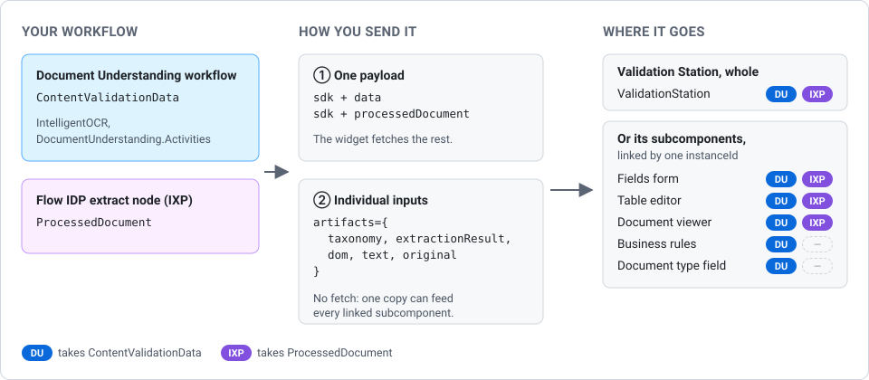

# @uipath/ui-widgets-classification-station

A React wrapper for the UiPath Document Understanding **Classification Station**, the human-in-the-loop _split and classify_ step. A reviewer sees a file's pages next to the original document, and confirms or corrects how the classifier split it into documents and which document type each one is. The widget loads the file, and saves the review back.

It is the step before extraction. To review the extracted values of a classified document, use [`@uipath/ui-widgets-validation-station`](https://github.com/UiPath/uipath-ui-widgets/tree/develop/packages/validation-station).

## Pick your path



The Classification Station takes **Document Understanding data only**: the `CsContentValidationData` a classification validation task hands over. Flow IDP (IXP) documents are not supported yet.

Send it as **① one payload**, `sdk` + `data`, and the widget fetches the rest and saves the review. Or send **② the pieces** you already hold as `artifacts`, and save them yourself. The quick start below takes ①.

## Install

```bash
npm install @uipath/ui-widgets-classification-station @uipath/uipath-typescript @uipath/coded-action-app react@^19.2.0 react-dom@^19.2.0
npm install --save-dev @uipath/du-classification-station-wc@1.0.0-rc.2
```

`@uipath/uipath-typescript` `>= 1.5.1` is required. `@uipath/coded-action-app` is only for a Coded Action App. Every type the package uses is exported from its root.

## Host the web component

The widget renders the Classification Station web component, loaded at runtime from your app's own files rather than bundled. Three steps:

1. **Stage it.** Copy `node_modules/@uipath/du-classification-station-wc` into `public/du-cs-wc` before every `dev` and `build`. The Validation Station samples' [`stage-du-wc.mjs`](https://github.com/UiPath/uipath-typescript/blob/main/samples/document-validation-app/scripts/stage-du-wc.mjs) does this for its own package; change the package name and the `public/` folder, and wire it to `predev` and `prebuild`.
2. **Load it once,** at startup, before rendering the widget:

   ```ts title="src/main.tsx"
   import { configureClassificationStationWc } from "@uipath/ui-widgets-classification-station";

   configureClassificationStationWc({ includeFonts: true }).catch((error) => {
     console.error(
       "Classification Station web component failed to load",
       error,
     );
   });
   ```

3. **Keep `public/du-cs-wc` out of git.** It is generated, and about 17 MB.

> **Note: Keep the `.catch`**
> The returned promise is the only place a load failure surfaces. Without it, a missing `du-cs-wc` leaves the widget on its loading state with no error.

Serve the **whole** package: without `du-assets/`, pages, thumbnails and translations fail silently. For another location, CSP and version skew, the Validation Station's [Hosting in depth](https://github.com/UiPath/uipath-ui-widgets/blob/develop/packages/validation-station/docs/hosting.md) applies here too, with `du-cs-wc` for `du-vs-wc`.

## Quick start: a Coded Action App

A Document Understanding workflow raises a classification validation action; Action Center opens your app on it. The app reads the task, renders the widget, and completes the task once the reviewer saves. The wiring is the same as the Validation Station's [quick start](https://github.com/UiPath/uipath-ui-widgets/tree/develop/packages/validation-station#quick-start-a-coded-action-app); only the widget and its input change.

```ts title="src/uipath.ts"
import { UiPath } from "@uipath/uipath-typescript/core";
import { CodedActionApp } from "@uipath/coded-action-app";

// No arguments and no initialize(): Action Center supplies the auth.
export const sdk = new UiPath();
export const codedActionApp = new CodedActionApp();
```

```tsx title="src/Classification.tsx"
import { useEffect, useMemo, useState } from "react";
import {
  ClassificationStation,
  type CsContentValidationData,
} from "@uipath/ui-widgets-classification-station";
import { MessageSeverity } from "@uipath/coded-action-app";
import { codedActionApp, sdk } from "./uipath";

// Name it after the input your action schema declares.
interface ActionInputs {
  classificationValidationData?: CsContentValidationData;
}

export function Classification() {
  const [task, setTask] = useState<{
    data: ActionInputs;
    folderId: number;
    isReadOnly: boolean;
  } | null>(null);

  useEffect(() => {
    codedActionApp.getTask().then((t) =>
      setTask({
        data: (t.data as ActionInputs) ?? {},
        folderId: t.folderId,
        isReadOnly: t.isReadOnly,
      }),
    );
  }, []);

  // The widget reads the bucket in the folder the payload names; fall back to the task's folder.
  const data = useMemo(() => {
    const payload = task?.data.classificationValidationData;
    if (!payload) return null;
    return payload.FolderId != null || payload.FolderKey != null
      ? payload
      : { ...payload, FolderId: task.folderId };
  }, [task]);

  if (!task) return <p>Loading the action…</p>;
  if (!data) return <p>This action has no classification input.</p>;

  return (
    <ClassificationStation
      sdk={sdk}
      data={data}
      isReadonly={task.isReadOnly}
      onSubmit={async (_request, result) => {
        if (!result?.success) {
          codedActionApp.showMessage(
            result?.error ?? "Failed to save the classification.",
            MessageSeverity.Error,
          );
          return;
        }
        // completeTask replaces the task's data: pass all of it back, not just your changes.
        await codedActionApp.completeTask("Submit", task.data);
      }}
    />
  );
}
```

> **Note: Theming**
> Add a `light` or `dark` class to `<body>`; the widget's stylesheets key off it. `theme` and `language` default to `"light"` and English.

## Saving

| Callback            | With `sdk` + `data`, the widget…                                                     | Left to you                                                     |
| ------------------- | ------------------------------------------------------------------------------------ | --------------------------------------------------------------- |
| `onSubmit`          | writes the classification to `ValidatedClassificationResultsPath`                    | **Completing the task**, and only when `result.success` is true |
| `onSaveAsDraft`     | writes the same file; the next load opens on it. On by default (`enableSaveAsDraft`) | Telling the reviewer                                            |
| `onReportException` | nothing                                                                              | Persisting it yourself                                          |

A submit and a draft write the same file: what makes a submit final is completing the task. The widget shows no errors of its own; tell the reviewer from the callback. It reads and writes what the cloud Classification Station in Action Center does, so either reopens what the other saved.

**OAuth scopes.** The widget needs `OR.Buckets`; the app needs `OR.Tasks` to read and complete the task. In a Coded Action App, set them as `scope` in `uipath.json`.

## Core props

| Prop                                             | Type                            | Description                                                                                 |
| ------------------------------------------------ | ------------------------------- | ------------------------------------------------------------------------------------------- |
| `sdk`                                            | `UiPath`                        | The SDK instance. Needed whenever the widget fetches or saves (①)                           |
| `data`                                           | `CsContentValidationData`       | The classification task's payload                                                           |
| `artifacts`                                      | `CsDocumentArtifacts`           | The pieces you already hold (②). No fetch happens. Pass `documentId` with them              |
| `theme`                                          | `CsTheme`                       | `'light'` (default), `'dark'`, `'light-hc'`, `'dark-hc'`, `'future-light'`, `'future-dark'` |
| `language`                                       | `ClassificationStationLanguage` | Defaults to English                                                                         |
| `isReadonly`                                     | `boolean`                       | Read-only review. Pass the task's `isReadOnly`                                              |
| `enableSaveAsDraft`                              | `boolean`                       | Offers **Save as draft**. Defaults to `true`                                                |
| `onSubmit`, `onSaveAsDraft`, `onReportException` | `(request, result?) => void`    | See [Saving](#saving)                                                                       |

> **Warning: Keep `data` and `artifacts` stable**
> The element compares its inputs by reference. A new object replaces the loaded classification wholesale and discards unsaved edits. Keep it in React state.

The not-classified group, page reordering, shortcuts, the change callbacks (`onDirtyChange`, `onSplitClassifications`, …) and the round-trip helpers are in [Data sources, props and outputs](https://github.com/UiPath/uipath-ui-widgets/blob/develop/packages/classification-station/docs/reference.md).

## Troubleshooting

| Symptom                                                     | Likely cause                                                                                                         |
| ----------------------------------------------------------- | -------------------------------------------------------------------------------------------------------------------- |
| The widget stays on its loading state                       | The web component did not load: check the `.catch` on `configureClassificationStationWc`, and `du-cs-wc`             |
| `basedomain query parameter is missing`                     | The app was opened directly, not from an Action Center task                                                          |
| An error naming a missing folder (`FolderId` / `FolderKey`) | The payload has neither. Fill it from `task.folderId`, as in the quick start                                         |
| A 401 or 403 when loading or saving                         | A missing scope. See [Saving](#saving)                                                                               |
| Unsaved edits vanish                                        | A new `data` or `artifacts` object on re-render. Keep it stable                                                      |
| With `artifacts`: the document does not render              | `original` must be a data URI (`data:application/pdf;base64,…`), and `docTypes` the taxonomy's `DocumentTypes` array |

## Going further

- [Data sources, props and outputs](https://github.com/UiPath/uipath-ui-widgets/blob/develop/packages/classification-station/docs/reference.md): what self-fetching reads and writes, loading and saving from your own code, every prop and output, the language list.
- [Hosting in depth](https://github.com/UiPath/uipath-ui-widgets/blob/develop/packages/validation-station/docs/hosting.md), written for the Validation Station; the same applies with `du-cs-wc`.
- [Validation Station](https://github.com/UiPath/uipath-ui-widgets/tree/develop/packages/validation-station), the next step: reviewing the extracted values.

<!-- docs:ignore -->

## Development

```bash
# Build
npm run build

# Run tests
npm test

# Run tests in watch mode
npm run test:watch
```

## License

MIT

<!-- /docs:ignore -->
