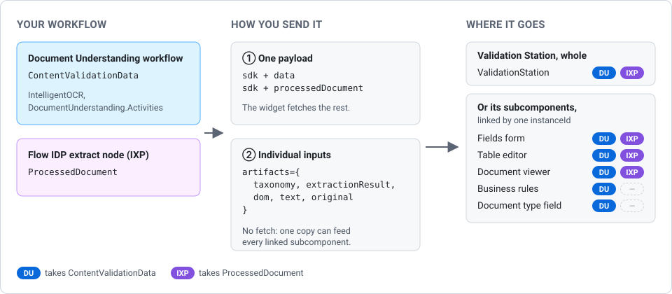

# @uipath/ui-widgets-document-viewer

A React wrapper for the UiPath Document Understanding **document viewer**: the viewer of the Validation Station and the Classification Station, as a component of its own. It renders a digitised document's pages, its text, or both; lets the user search, zoom, rotate and select words or areas; highlights content references; and reports the user's selection as one.

It holds no extraction or classification data and edits nothing. Use it as a document preview, or next to a form of your own, linked through content references: the same shape an extracted value's `Reference` has.

## Pick your path



| You have                                                           | Pass                                        | Who fetches                                                                               |
| ------------------------------------------------------------------ | ------------------------------------------- | ----------------------------------------------------------------------------------------- |
| A Validation or Classification Station task's data (DU)            | **①** `sdk` + `data`                        | The widget: `DocumentObjectModelPath`, plus `EncodedDocumentPath` and `TextPath` when set |
| The document's pieces, already fetched (DU or a Flow IXP document) | **②** `artifacts={{ dom, original, text }}` | You                                                                                       |

`data` is any object with the bucket fields the viewer reads: a `ContentValidationData` and a `CsContentValidationData` both qualify. There is no `processedDocument` prop: for a Flow IDP document, pass its pieces. The `artifacts` you already fetched for a station can be passed as they are.

`original` (a base64 data URI) enables the page view and `text` the text view; with both, the user can switch.

## Install

```bash
npm install @uipath/ui-widgets-document-viewer @uipath/uipath-typescript react@^19.2.0 react-dom@^19.2.0
npm install --save-dev @uipath/du-document-viewer-wc@1.0.0-beta.1
```

## Host the web component

The same three steps as the [Validation Station's](https://github.com/UiPath/uipath-ui-widgets/tree/develop/packages/validation-station#host-the-web-component), with this package's names:

1. **Stage** the whole `node_modules/@uipath/du-document-viewer-wc` into `public/du-dv-wc` before every `dev` and `build`. Without `du-assets/`, rendering and translations fail silently.
2. **Load it once,** at startup: `configureDocumentViewerWc({ includeFonts: true }).catch(console.error)`. The promise is the only place a load failure surfaces.
3. **Keep `public/du-dv-wc` out of git.** It is generated, and about 10 MB.

`includeFonts` adds Material Icons only; the viewer's text inherits your app's font stack. For another location (`deploymentUrl`), CSP and version skew, see [Hosting in depth](https://github.com/UiPath/uipath-ui-widgets/blob/develop/packages/validation-station/docs/hosting.md), with `du-dv-wc` for `du-vs-wc`.

## Quick start

```tsx
import { DocumentViewer } from "@uipath/ui-widgets-document-viewer";

// A Validation or Classification Station task's data: the viewer reads its DOM, original and text paths.
function Preview({ sdk, task }) {
  return <DocumentViewer sdk={sdk} data={task.data} />;
}
```

> **Note: Theming**
> Add a `light` or `dark` class to `<body>`; the widget's stylesheets key off it.

In a Coded Action App, `sdk` and the task come from `new UiPath()` and `getTask()`, as in the Validation Station's [quick start](https://github.com/UiPath/uipath-ui-widgets/tree/develop/packages/validation-station#quick-start-a-coded-action-app). To fetch ahead of time, or once for several components, use `fetchDvDocumentArtifacts(sdk, data)` or the `useDvDocumentArtifacts(sdk, data)` hook, and pass the result as `artifacts`.

## Linking it to a form

The viewer links through content references, in and out:

```tsx
import { useMemo, useState } from "react";
import { DocumentViewer } from "@uipath/ui-widgets-document-viewer";
import { CompactFieldsForm } from "@uipath/ui-widgets-validation-station";

function Review({ artifacts }) {
  const [selected, setSelected] = useState(null);
  const references = useMemo(
    () =>
      artifacts.extractionResult.ResultsDocument.Fields.flatMap((field) =>
        field.Values.map((value) => value.Reference),
      ),
    [artifacts],
  );

  return (
    <>
      <DocumentViewer
        artifacts={artifacts}
        highlightReference={selected}
        passiveReferences={references}
        onReferenceSelect={({ text, reference }) =>
          console.log(text, reference)
        }
      />
      <CompactFieldsForm
        artifacts={artifacts}
        onFieldValueSelected={(e) =>
          setSelected(e.FieldValue?.Reference ?? null)
        }
      />
    </>
  );
}
```

> **Note: Linking through `instanceId`**
> This viewer cannot share a store with the Validation Station subcomponents through `instanceId` yet. When you need that (selecting a field highlights it, a rule click focuses its value, with nothing wired by hand), use the Validation Station's own `DocumentViewer` subcomponent. See [Building with subcomponents](https://github.com/UiPath/uipath-ui-widgets/blob/develop/packages/validation-station/docs/validation-station-subcomponents.md).

## Props

| Prop                 | Type                                         | Default   | Description                                                                                                    |
| -------------------- | -------------------------------------------- | --------- | -------------------------------------------------------------------------------------------------------------- |
| `sdk`                | `UiPath`                                     | —         | Required for self-fetching (①)                                                                                 |
| `data`               | `DocumentViewerContentData`                  | —         | A task's bucket descriptor. Required for self-fetching (①)                                                     |
| `artifacts`          | `DvDocumentArtifacts`                        | —         | `{ dom, original, text }` (②). No fetch happens                                                                |
| `theme`              | `DvTheme`                                    | `'light'` | `'light'`, `'dark'`, `'light-hc'`, `'dark-hc'`, `'future-light'`, `'future-dark'`                              |
| `language`           | `DocumentViewerLanguage`                     | `English` | One of the 14 languages the viewer ships; the enum lists them                                                  |
| `options`            | `DocumentViewerOptions`                      | —         | Which controls show and how selection behaves; see below                                                       |
| `highlightReference` | `ResultsContentReference \| null`            | —         | Highlights and scrolls to it; `null` clears the highlight                                                      |
| `passiveReferences`  | `readonly ResultsContentReference[] \| null` | —         | Drawn as a passive highlight, e.g. every extracted value. The user can hide it from the viewer menu            |
| `outlineReference`   | `ResultsContentReference \| null`            | —         | Outlines it, e.g. the value hovered in another component; `null` clears it                                     |
| `goToPage`           | `GoToPage`                                   | —         | `{ target: 2 }` or `'next'`, `'previous'`, `'first'`, `'last'`. Pass a **new object** for every navigation     |
| `persistent`         | `boolean`                                    | `false`   | Renders the persistent element variant, which survives portal/DOM detachment and is force-destroyed on unmount |
| `className`, `style` |                                              | —         | Set on the element                                                                                             |

`options` is the same `DocumentViewerOptions` the Validation Station takes as `options.documentViewerOptions` and the Classification Station as `documentViewerOptions`: `floatingButtonsOptions` (`hideTextView`, `hideInteractionTypeButton`, `defaultInteractionType`, `hideSearch`, `hideKeyboardShortcutsButton`, `hideSwitchPanelSidesButton`, `hideExtractedTokensToggle`), `autoRotationThreshold` and `disableSelection`. Pass a new object to change it.

## Outputs

| Prop                  | Fires when                                                                                              |
| --------------------- | ------------------------------------------------------------------------------------------------------- |
| `onReady`             | The document is rendered                                                                                |
| `onPageCountChange`   | The document is rendered; detail is the page count                                                      |
| `onCurrentPageChange` | Another page comes into view (1-based), and once with the initial page                                  |
| `onTextModeChange`    | The user switches to the text view (`true`) or back                                                     |
| `onGoToPageResult`    | A `goToPage` command finished; `pageNumber` is the page reached, or `-1` when it failed                 |
| `onReferenceSelect`   | The user selects words or clears the selection: `{ text, reference }`, with empty `Tokens` when cleared |
| `onSwitchPanelSides`  | The user asks to move the viewer to the other side of your layout. The element does not move itself     |

## Troubleshooting

| Symptom                                  | Likely cause                                                                                      |
| ---------------------------------------- | ------------------------------------------------------------------------------------------------- |
| Nothing renders, no error                | The web component did not load: check the `.catch` on `configureDocumentViewerWc`, and `du-dv-wc` |
| Only the text view, or a blank page view | `original` is missing, or not a data URI (`data:application/pdf;base64,…`)                        |
| Highlights land in the wrong place       | A hand-built `dom` whose `Pages[].Size` is not `[0, 0, width, height]`                            |
| A 401 or 403 when loading                | Self-fetching needs `OR.Buckets` (or `OR.Buckets.Read`)                                           |
| `goToPage` works once, then nothing      | The same object was passed again. Pass a new one for every navigation                             |

<!-- docs:ignore -->

## Development

```bash
# Build
npm run build

# Run tests
npm test

# Run tests in watch mode
npm run test:watch
```

## License

MIT

<!-- /docs:ignore -->
