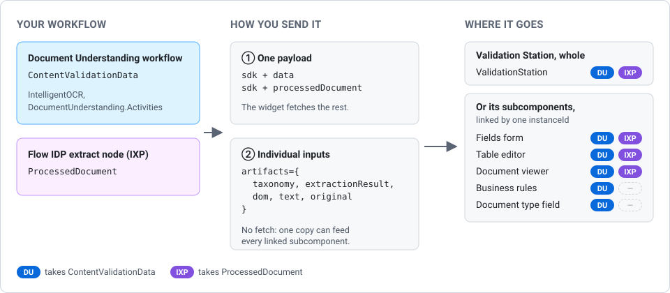

# @uipath/ui-widgets-validation-station

React component for the UiPath Document Understanding **Validation Station**, the screen where a reviewer checks and corrects the values extracted from a document, side by side with the document itself. Give it the output of an extraction and it fetches the document, shows it for review, and saves the reviewer's changes. It runs in any React app, typically a [Coded Action App](https://uipath.github.io/uipath-typescript/coded-action-apps/getting-started/) whose task includes a review step; completing that task stays with your app.

## Pick your path



Your workflow decides the contract:

- **A Document Understanding workflow** hands over the `ContentValidationData` that its _Create Document Validation Artifacts_ activity outputs (IntelligentOCR, DocumentUnderstanding.Activities). Pass it as `data`.
- **A Flow IDP extract node** hands over a `ProcessedDocument` (IXP). Pass it as `processedDocument`.

Send it as **① one payload**, with `sdk` + `data` or `sdk` + `processedDocument`, and the widget fetches the rest and saves the review. Or send **② the individual inputs** you already hold as `artifacts`, and save the review yourself. The quick start below takes ①.

| Widget                                                                                                                                                                                                     | DU ① | DU ② | IXP ① | IXP ② |
| ---------------------------------------------------------------------------------------------------------------------------------------------------------------------------------------------------------- | :--: | :--: | :---: | :---: |
| `ValidationStation`, the whole screen                                                                                                                                                                      |  ✓   |  ✓   |   ✓   |   ✓   |
| [Subcomponents](https://github.com/UiPath/uipath-ui-widgets/blob/develop/packages/validation-station/docs/validation-station-subcomponents.md) `CompactFieldsForm`, `CompactTableEditor`, `DocumentViewer` |  ✓   |  ✓   |   ✓   |   ✓   |
| [Subcomponents](https://github.com/UiPath/uipath-ui-widgets/blob/develop/packages/validation-station/docs/validation-station-subcomponents.md) `CompactBusinessRules`, `CompactDocTypeField`               |  ✓   |  ✓   |   —   |   —   |

Start with `ValidationStation`. Reach for the subcomponents only when the standard screen does not fit your layout.

## Install

```bash
npm install @uipath/ui-widgets-validation-station @uipath/uipath-typescript @uipath/coded-action-app react@^19.2.0 react-dom@^19.2.0
npm install --save-dev @uipath/du-validation-station-wc@1.0.0-rc.6
```

`@uipath/uipath-typescript` `>= 1.5.1` is required. `@uipath/coded-action-app` is only for a Coded Action App. The package is written in TypeScript, and every type it uses is exported from its root.

## Host the web component

The widget renders the Validation Station web component, which is loaded at runtime from your app's own files rather than bundled. There is no bundler configuration to write. Three steps:

1. **Stage it.** Copy `node_modules/@uipath/du-validation-station-wc` into `public/du-vs-wc` before every `dev` and `build`. Take the [`stage-du-wc.mjs`](https://github.com/UiPath/uipath-typescript/blob/main/samples/document-validation-app/scripts/stage-du-wc.mjs) script from the samples as-is:

   ```json title="package.json"
   {
     "scripts": {
       "stage-du-wc": "node scripts/stage-du-wc.mjs",
       "predev": "npm run stage-du-wc",
       "prebuild": "npm run stage-du-wc"
     }
   }
   ```

2. **Load it once,** at startup, before rendering any widget:

   ```ts title="src/main.tsx"
   import { configureValidationStationWc } from "@uipath/ui-widgets-validation-station";

   configureValidationStationWc({ includeFonts: true }).catch((error) => {
     console.error("Validation Station web component failed to load", error);
   });
   ```

3. **Keep `public/du-vs-wc` out of git.** It is generated, and about 35 MB.

> **Note: Keep the `.catch`**
> The returned promise is the only place a load failure surfaces. Without it, a missing or misplaced `du-vs-wc` leaves the widget on its loading state with no error.

The default location works for a Coded App and for a plain host alike. For another location, CSP and version skew, see [Hosting in depth](https://github.com/UiPath/uipath-ui-widgets/blob/develop/packages/validation-station/docs/hosting.md).

## Quick start: a Coded Action App

A Document Understanding workflow raises a validation action; Action Center opens your app on it. The app reads the task, renders the widget, and completes the task once the reviewer submits. This is a cut-down version of the [`action-app-with-document-validation`](https://github.com/UiPath/uipath-typescript/tree/main/samples/coded-action-apps/action-app-with-document-validation) sample, whose action schema declares one input, `contentValidationData`, and one outcome, `Submit`.

```ts title="src/uipath.ts"
import { UiPath } from "@uipath/uipath-typescript/core";
import { CodedActionApp } from "@uipath/coded-action-app";

// No arguments and no initialize(): Action Center supplies the auth.
export const sdk = new UiPath();
export const codedActionApp = new CodedActionApp();
```

```tsx title="src/Validation.tsx"
import { useEffect, useMemo, useState } from "react";
import {
  ValidationStation,
  type IValidationStationOptions,
} from "@uipath/ui-widgets-validation-station";
import type { DuFramework } from "@uipath/uipath-typescript/document-understanding";
import { MessageSeverity } from "@uipath/coded-action-app";
import { codedActionApp, sdk } from "./uipath";

interface ActionInputs {
  contentValidationData?: DuFramework.ContentValidationData;
}

const OPTIONS: IValidationStationOptions = {
  emitDtoStateChanges: true, // without it, "Save as draft" saves nothing
  hideReportAsExceptionButton: true, // it needs a DU validation task, not an app task
};

export function Validation() {
  const [task, setTask] = useState<{
    data: ActionInputs;
    folderId: number;
    isReadOnly: boolean;
  } | null>(null);

  useEffect(() => {
    codedActionApp.getTask().then((t) =>
      setTask({
        data: (t.data as ActionInputs) ?? {},
        folderId: t.folderId,
        isReadOnly: t.isReadOnly,
      }),
    );
  }, []);

  // The widget reads the bucket in the folder the payload names; fall back to the task's folder.
  const data = useMemo(() => {
    const payload = task?.data.contentValidationData;
    if (!payload) return null;
    return payload.FolderId != null || payload.FolderKey != null
      ? payload
      : { ...payload, FolderId: task.folderId };
  }, [task]);

  if (!task) return <p>Loading the action…</p>;
  if (!data) return <p>This action has no contentValidationData input.</p>;

  return (
    <ValidationStation
      sdk={sdk}
      data={data}
      isReadonly={task.isReadOnly}
      options={OPTIONS}
      onSubmit={async (_request, result) => {
        if (!result?.success) {
          codedActionApp.showMessage(
            result?.error ?? "Failed to submit the document.",
            MessageSeverity.Error,
          );
          return;
        }
        // completeTask replaces the task's data: pass all of it back, not just your changes.
        await codedActionApp.completeTask("Submit", task.data);
      }}
      onSaveAsDraft={(_request, result) =>
        codedActionApp.showMessage(
          result?.success
            ? "Draft saved."
            : (result?.error ?? "Failed to save the draft."),
          result?.success ? MessageSeverity.Success : MessageSeverity.Error,
        )
      }
    />
  );
}
```

> **Note: Theming**
> Add a `light` or `dark` class to `<body>`; the widget's stylesheets key off it. `theme` and `language` default to `"light"` and English. The sample maps Action Center's theme onto both.

### From a Flow IDP extract node (IXP)

Pass the `ProcessedDocument` instead of `data`, and complete the task with the validated document the widget hands back:

```tsx
<ValidationStation
  sdk={sdk}
  processedDocument={processedDocument}
  onSubmit={(_request, result) => {
    // The node downstream reads this document as its output. Complete with it
    // verbatim, even when result.success is false: a failed record write must
    // not block the review.
    completeTask(result?.processedDocument);
  }}
/>
```

The full IXP behaviour, from loading drafts to the record format, is in [Data sources](https://github.com/UiPath/uipath-ui-widgets/blob/develop/packages/validation-station/docs/data-sources.md#ixp-processeddocument).

### As a standalone web app

Outside Action Center, construct the SDK with your external application and sign in first: `new UiPath({ baseUrl, orgName, tenantName, clientId, redirectUri, scope })`, then `await sdk.initialize()` inside an effect, since under OAuth it navigates to the identity provider and back. Serve `redirectUri` from the same app. The [`document-validation-app`](https://github.com/UiPath/uipath-typescript/tree/main/samples/document-validation-app) sample is a full inbox built this way.

## Saving

The widget's own action bar offers **Submit**, **Save as draft** and **Report as exception**. Each fires one callback, with the request the web component produced and, when the widget saved it itself (①), the outcome as `result`. The widget shows no errors of its own; tell the reviewer from the callback.

| Callback            | With `sdk` + `data`, the widget…                                              | Left to you                                                                             |
| ------------------- | ----------------------------------------------------------------------------- | --------------------------------------------------------------------------------------- |
| `onSubmit`          | runs `ProcessExtractedData` and uploads to `ValidatedExtractionResultsPath`   | **Completing the task**, and only when `result.success` is true                         |
| `onSaveAsDraft`     | uploads the in-progress values; the next load opens on them                   | Telling the reviewer. Needs `options={{ emitDtoStateChanges: true }}`                   |
| `onReportException` | does nothing for a DU document; records a rejection for a `ProcessedDocument` | For DU, persisting it yourself, or hiding the button with `hideReportAsExceptionButton` |

With ② (`artifacts`, no `sdk`), every callback carries only the request and the saving is yours; the exported `submitValidatedData` and `saveValidatedDataAsDraft` do what the widget would have. See [Data sources](https://github.com/UiPath/uipath-ui-widgets/blob/develop/packages/validation-station/docs/data-sources.md#owning-the-round-trip).

**OAuth scopes.** The token needs `OR.Buckets` for a DU document, and `Traces.Api` plus `OR.Buckets.Read` for a `ProcessedDocument`. The app needs `OR.Tasks` to read and complete the task. In a Coded Action App, set them as `scope` in `uipath.json`, on an external application that grants them.

## Core props

| Prop                                             | Type                                          | Description                                                                                                       |
| ------------------------------------------------ | --------------------------------------------- | ----------------------------------------------------------------------------------------------------------------- |
| `sdk`                                            | `UiPath`                                      | The SDK instance. Needed whenever the widget fetches or saves (①)                                                 |
| `data`                                           | `ContentValidationData`                       | A Document Understanding workflow's output. Wins over `processedDocument` when both are set                       |
| `processedDocument`                              | `ProcessedDocument`                           | A Flow IDP extract node's output                                                                                  |
| `artifacts`                                      | `DuDocumentArtifacts \| IxpDocumentArtifacts` | The individual inputs you already hold (②). No fetch happens. Pass `documentId` with them                         |
| `theme`                                          | `DuTheme`                                     | `'light'` (default), `'dark'`, `'light-hc'`, `'dark-hc'`, `'future-light'`, `'future-dark'`                       |
| `language`                                       | `ValidationStationLanguage`                   | Defaults to `ValidationStationLanguage.English`                                                                   |
| `isReadonly`                                     | `boolean`                                     | Read-only review. Pass the task's `isReadOnly`                                                                    |
| `options`                                        | `IValidationStationOptions`                   | UI flags, such as `emitDtoStateChanges`, `hideReportAsExceptionButton`, `hideDiscardButton`, `fieldFilterOptions` |
| `onSubmit`, `onSaveAsDraft`, `onReportException` | `(request, result?) => void`                  | See [Saving](#saving)                                                                                             |

Every other prop, the state callbacks (`onLoaded`, `onDirtyChange`, `onFieldValueChanged`, …) and the commands that set or focus a value by path are in [Props, events and commands](https://github.com/UiPath/uipath-ui-widgets/blob/develop/packages/validation-station/docs/events-and-commands.md).

## Troubleshooting

| Symptom                                                       | Likely cause                                                                                                                  |
| ------------------------------------------------------------- | ----------------------------------------------------------------------------------------------------------------------------- |
| The widget stays on its loading state                         | The web component did not load: check the `.catch` on `configureValidationStationWc`, and that `du-vs-wc` is in your build    |
| `basedomain query parameter is missing`                       | The app was opened directly, not from an Action Center task. Open it from the task                                            |
| An error naming a missing folder (`FolderId` / `FolderKey`)   | The payload has neither. Fill it from `task.folderId`, as in the quick start                                                  |
| A 401 or 403 when loading or saving                           | A missing scope. See [Saving](#saving)                                                                                        |
| **Save as draft** does nothing                                | `options={{ emitDtoStateChanges: true }}` is not set                                                                          |
| The completed task has empty data                             | `completeTask` was given only part of the task's data. Pass all of it back                                                    |
| Icons render as words such as `expand_more`                   | Material Icons are not loaded. Pass `includeFonts: true`                                                                      |
| With `artifacts`: "document format unknown not supported"     | `original` is bare base64. It must be a data URI: `data:application/pdf;base64,…`                                             |
| With `artifacts`: no line items in a DU document              | The tables are in `ResultsDocument.Tables`, which is ignored. Put them in `ResultsDocument.Fields` as Table fields            |
| Subcomponents: fields show "Is missing", or panels don't sync | The `instanceId`: use the same one across one document's panels, and a different one per document and per contract (DU / IXP) |

## Going further

- [Data sources and the round trip](https://github.com/UiPath/uipath-ui-widgets/blob/develop/packages/validation-station/docs/data-sources.md): pre-fetched artifacts, loading and saving from your own code, and IXP documents in full.
- [Props, events and commands](https://github.com/UiPath/uipath-ui-widgets/blob/develop/packages/validation-station/docs/events-and-commands.md): every prop and callback, setting and focusing values by path, a custom confidence popover, the language list.
- [Hosting in depth](https://github.com/UiPath/uipath-ui-widgets/blob/develop/packages/validation-station/docs/hosting.md): the served folder's layout, `deploymentUrl`, fonts, CSP and version skew.
- [Subcomponents](https://github.com/UiPath/uipath-ui-widgets/blob/develop/packages/validation-station/docs/validation-station-subcomponents.md): build your own layout from the fields form, table editor, document viewer, business rules and document type panels.
- [Upgrading](https://github.com/UiPath/uipath-ui-widgets/blob/develop/packages/validation-station/UPGRADING.md): what each web component release changed, and moving off `1.0.x`.
- Sample apps, each with setup steps, also in the [Sample Apps Gallery](https://uipath.github.io/uipath-typescript/samples/):

  | Sample                                                                                                                                                                                                     | What it shows                                                             |
  | ---------------------------------------------------------------------------------------------------------------------------------------------------------------------------------------------------------- | ------------------------------------------------------------------------- |
  | [`coded-action-apps/action-app-with-document-validation`](https://github.com/UiPath/uipath-typescript/tree/main/samples/coded-action-apps/action-app-with-document-validation)                             | The quick start in full: `ValidationStation` as a Coded Action App        |
  | [`coded-action-apps/action-app-with-document-validation-subcomponents`](https://github.com/UiPath/uipath-typescript/tree/main/samples/coded-action-apps/action-app-with-document-validation-subcomponents) | The subcomponents in a custom layout, as a Coded Action App               |
  | [`document-validation-app`](https://github.com/UiPath/uipath-typescript/tree/main/samples/document-validation-app)                                                                                         | A standalone inbox of validation tasks, reviewed with `ValidationStation` |
  | [`document-validation-subcomponents-app`](https://github.com/UiPath/uipath-typescript/tree/main/samples/document-validation-subcomponents-app)                                                             | The same inbox, built from the subcomponents                              |

<!-- docs:ignore -->

## Development

```bash
# Build
npm run build

# Run tests
npm run test

# Run tests in watch mode
npm run test:watch
```

## License

MIT

<!-- /docs:ignore -->
